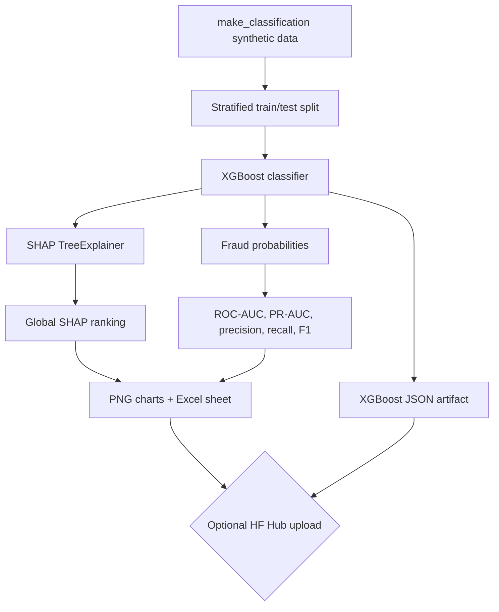

# Day 11 Architecture

## Modeling choices

The dataset is intentionally imbalanced so the example reflects a common fraud-detection challenge. `scale_pos_weight` is computed from the training split to give the minority class more influence during XGBoost training. The test set is stratified to retain a comparable fraud rate.

The model outputs probabilities. A threshold converts probabilities into operational predictions. Lowering the threshold generally increases recall while potentially increasing false positives; the right threshold depends on the cost of missed fraud, review capacity, and customer friction.

## Explainability

`shap.TreeExplainer` computes per-feature contributions for a sample of test transactions. The project aggregates mean absolute SHAP values for a global ranking and saves two charts. SHAP is an explanation of model behavior, not a causal explanation of why a transaction is truly fraudulent.

## Hugging Face role

Hugging Face is used as an optional versioned artifact registry. The local XGBoost JSON model, Excel report, JSON metrics, and PNG explanations can be uploaded to a model repository through `huggingface_hub`. No hosted LLM or inference provider is required for the training pipeline.
